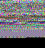

<!-- PDF annotation: place this image at bottom-right of page -000 -->
<!-- build.py: inject Image(mischievouslittlechicken.png, width=0.6in, height=0.6in) 
     in the right margin of the -000 page template, 0.35in from bottom, 0.35in from right -->

*The tOcM chunk is inside this image. The map is in the chicken.*
